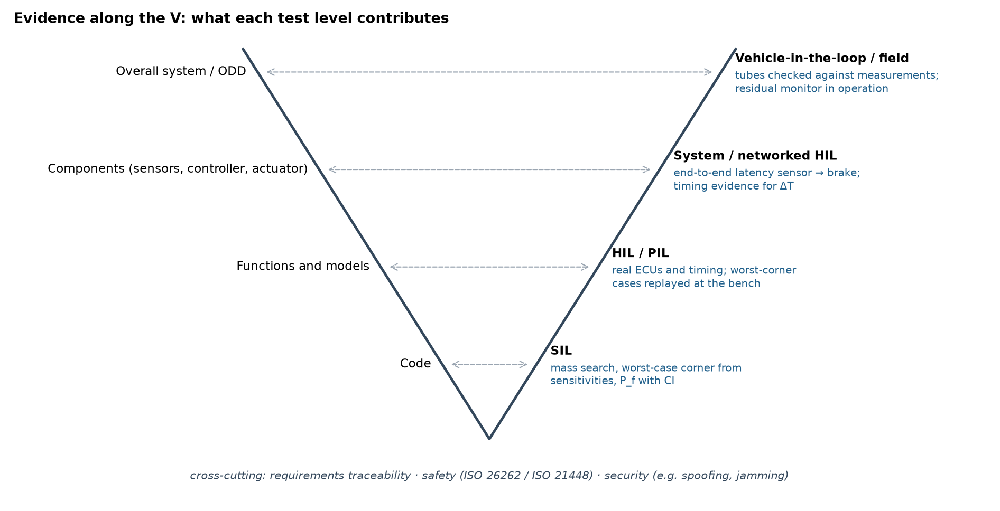

# Evidence concept: from worst-case bounds to field monitoring

Status 30 Oct 2026 · Christoph Funda · concept and research ideas, partly implemented in this repository. Everything that is not marked *implemented* is a proposal.

## Idea in one paragraph

Critical scenarios should not be found by brute-force sampling alone. The equations of the overall model, together with the admissible sensor and timing deviations, tell in advance where the system is weakest. Simulation then **validates** these predicted boundaries instead of searching blindly, hardware benches add real timing, and measurements in the vehicle check whether the model tubes hold. A residual monitor carries the same check into operation. Each test level of the V contributes a different piece of evidence, and the pieces are traced back to the requirement they support.

## Building blocks

| # | Idea | Formula / mechanism | Status |
| --- | --- | --- | --- |
| 1 | **Search space from the ODD** | scenario u × environment e × deviations θ (bias, scale, latency, faults) with a prior p(u) | implemented (`ats.py`) |
| 2 | **Worst case from the equations** | θ* = −sign(∂g/∂θ) ⊙ tol from a few probes instead of all 2^k corners | implemented, 13/13 flips found with 7 instead of 32 runs (`probe_study.py`) |
| 3 | **Time and amplitude tube** | δf ≲ Σ \|∂f/∂xᵢ\| δxᵢ + \|ḟ\| δT; tolerable latency ΔT* at the worst amplitude corner | implemented (`robustness.py`, `hyp_slip.py`) |
| 4 | **Physics-based learning** | keep f(ω, v, a, s(a, v)) physical, learn only the slip map s; keep its Jacobian small so the tube stays narrow | implemented as experiment H1/H1b: at the assumed tolerances the learned part was not the bottleneck, latency was |
| 5 | **Search at the boundary** | Bayesian optimisation, NSGA-II over criticality and likelihood, importance sampling, surrogate | implemented (`algos/`) |
| 6 | **Validation of each finding** | plausible (physics, ODD) and avoidable (oracle); robust_fail / fragile under Monte Carlo and corner scan; P_f with confidence interval | implemented; oracle at the platform brake limit still open (gap 0) |
| 7 | **Measurement vs. model** | f_meas ∈ [f_model − Δ, f_model + Δ] along the trajectory; Δ from the tube | proposal |
| 8 | **Residual monitor / dual checker** | an independent check, separate from the controller, that measured behaviour stays inside the tube; triggers degradation before the age limit of the world model | proposal |
| 9 | **Scenario selection by likelihood and severity** | rank test cases by −log p(u) and severity (impact speed, standing passengers) | partly (NSGA-II over g and −log p) |
| 10 | **Traceability** | requirement → system element → logical scenario → concrete scenario → test artefact → evidence, along a credible simulation process | proposal (`ROADMAP.md`) |

## What each test level contributes

| Level | Evidence | Why this level |
| --- | --- | --- |
| SIL | mass search, worst-case corners, P_f with confidence interval, regression of releases | cheap and reproducible; the place to be exhaustive |
| HIL / PIL | the same worst-corner cases with real ECUs and real timing | latency dominated the robust failures in the bench, and timing is only real on hardware |
| System / networked HIL | end-to-end latency sensor → fusion → decision → brake, fleet and infrastructure interfaces | where the timing budget ΔT is actually measured |
| Vehicle-in-the-loop / test track / site | tubes checked against measurements, a few confirming runs at the predicted boundaries | measurement closes the loop on model credibility |
| Operation | residual monitor, logged near misses fed back into the prior | evidence keeps accruing after acceptance |

Cross-cutting: requirements traceability, safety (ISO 26262, ISO 21448) and security. Security enters the same framework as a deviation that is correlated and adversarial rather than random, for example spoofing or jamming of localisation.

## Transfer to staged acceptance of automated transit (proposal)

For a staged acceptance such as cFAT → sFAT → iFAT → SAT the same logic applies: choose acceptance cases where the tolerance analysis points, measure timing along the chain as part of the evidence, and keep a residual monitor running from trial operation onward. The parameters would have to come from the real system; everything in this repository uses assumed values.

## Open questions

1. When does a worst-case corner from first-order sensitivities stay valid for piecewise-smooth closed loops (staged braking, latches)?
2. At which tolerance level does the Jacobian of a learned sub-model start to cost latency margin?
3. How can delay bounds and amplitude tubes be combined into one certified envelope that an assessor accepts?
4. How much of the residual risk can pre-computed bounds plus sampling carry, compared with mileage-based evidence?
