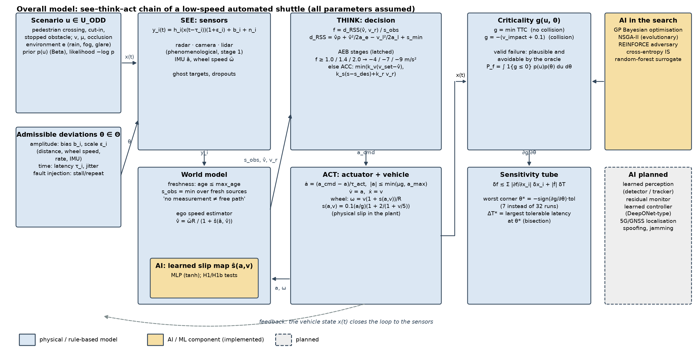
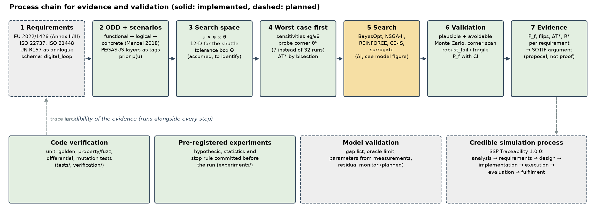

# Kritische Szenarien für ein L4-Shuttle: Gesamtidee und offene Fragen

Oct 29, 2026 · @Christoph Funda

## Gesamtidee

Kritische Szenarien für ein Level-4-Shuttle (ATS) werden nicht blind per Rechenkraft gesampelt, sondern aus der ODD, den Gleichungen des Gesamtmodells und der Messfehleranalyse in drei Stufen gewonnen: Vorabschätzung der Worst-Case-Kombinationen, gezielte Suche an den Grenzfällen, Validierung in der Simulation.

1. **ODD → Suchraum:** Szenarioparameter (Geschwindigkeit, Querung, Verdeckung, Reibwert), Umgebung (Regen, Nebel, Gegenlicht) und die zulässigen Sensor- und Zeitabweichungen (Bias, Skalierung, Latenz) bilden zusammen einen Raum mit Prior.
2. **Gleichungen → Worst-Case vorab:** Aus der Sensitivität des Gesamtmodells (Jacobi-Matrix der Entscheidungsgröße, Zeit- und Amplitudenschlauch) folgt die ungünstigste Ecke der Toleranzbox mit wenigen Auswertungen statt aller 2^k Kombinationen.
3. **Suche an den Grenzfällen:** Bayes'sche Optimierung, NSGA-II, Importance Sampling und Surrogate suchen im Szenarioraum, wobei die Worst-Case-Ecke als Grenzfall mitgeführt wird.
4. **Validierung:** Jeder Fund wird auf Plausibilität (Physik, ODD) und Vermeidbarkeit (Oracle) geprüft, dann per Monte-Carlo und Toleranzecken auf Robustheit (robust\_fail, fragile, robust\_pass) eingestuft.

Die Kette ist gebaut und getestet (Bench: [github.com/Twirl1984/ats-critical-scenario-bench](https://github.com/Twirl1984/ats-critical-scenario-bench)); belegt ist bisher, dass Stufe 2 mit 11 statt 33 Simulationen je Szenario arbeitet und im Test alle Brute-Force-Treffer reproduziert (Abschnitt „Vorabschätzung").

## Gesamtmodell mit Messfehlern und Zeitabweichungen

Das Gesamtsystem ist See-Think-Act: Sensoren (Radar, Kamera, Lidar, Stufe 1 phänomenologisch) liefern mit Latenz Messwerte an ein Weltmodell mit Altersgrenze, daraus entsteht ein Entscheidungssignal f, das gestufte Bremseingriffe auslöst, die über einen Aktuator mit Verzögerung auf das Fahrzeug wirken.

Messgrößen mit Abweichung und Zeitversatz (Notizen: f(w, v, s, a), Schlupf = f(a, v)):

```latex
y_i(t)=h_i\big(x(t-\tau_i)\big)\,(1+\varepsilon_i)+b_i+n_i,\qquad |\varepsilon_i|\le\bar\varepsilon_i,\ |b_i|\le\bar b_i,\ 0\le\tau_i\le\bar\tau_i
```

Entscheidungssignal und seine Abweichung (Amplitude plus Zeit):

```latex
\Delta f\;\lesssim\;\sum_i\Big|\frac{\partial f}{\partial x_i}\Big|\,\Delta x_i\;+\;|\dot f|\,\Delta T,\qquad f=\frac{d_{\mathrm{RSS}}(v,v_r)}{s}
```

Kritikalitätsmaß g (kleinste TTC, bei Kollision negative Aufprallgeschwindigkeit) und das Suchproblem über Szenario u und zulässige Abweichung θ:

```latex
\min_{u\in\mathcal U_{\mathrm{ODD}},\ \theta\in\Theta}\ g(u,\theta)\quad\text{bzw.}\quad P_f=\int \mathbf 1\{g(u,\theta)\le 0\}\,p(u)\,p(\theta)\,du\,d\theta
```

Implementiert ist das als ODD-gesteuertes Problem mit 12 Dimensionen (Fußgängerquerung): 6 Szenarioparameter, 1 Umgebung, 5 Abweichungen (Distanz-Bias, Raddrehzahl-Skalierung, Raten-Bias, IMU-Bias, Zusatzlatenz). Alle Zahlenwerte der Sensoren und Toleranzen sind Annahmen und müssen aus Datenblatt und Messung identifiziert werden.

## Gesamtmodell: Gleichungen, Blockbild, KI-Stellen und Prozesskette



**Gleichungen des implementierten Modells** (1D-Längsdynamik, alle Zahlenwerte Annahmen; Code: `sim.py`, `suite.py`, `world.py`).

Strecke (Fahrzeug mit Aktor, physikalischer Schlupf):

```latex
\dot x = v,\qquad \dot v = a,\qquad \dot a = \frac{a_{\mathrm{cmd}}-a}{\tau_{\mathrm{act}}},\qquad |a|\le \min(\mu g,\ a_{\max}),\qquad
\omega = \frac{v\,(1+s(a,v))}{R},\qquad s(a,v)=0{,}1\,\frac{a}{g}\Big(1+\frac{2}{1+v/5}\Big)
```

Sensoren mit Abweichung und Zeitversatz, Weltmodell mit Altersgrenze:

```latex
y_i(t)=h_i\big(x(t-\tau_i)\big)(1+\varepsilon_i)+b_i+n_i,\qquad
s_{\mathrm{obs}}(t)=\min_{i:\ t-t_i\le t_{\max}} y_i,\qquad \text{keine frische Quelle}\Rightarrow \text{keine Aussage (nicht „frei“)}
```

Geschwindigkeitsschätzer (Fixpunkt; hier sitzt das gelernte Teilmodell ŝ), Entscheidung und Regler:

```latex
\hat v=\frac{\tilde\omega R}{1+\hat s(\tilde a,\hat v)},\qquad
f=\frac{d_{\mathrm{RSS}}(\hat v,v_r)}{s_{\mathrm{obs}}},\quad d_{\mathrm{RSS}}=\hat v\rho+\frac{\hat v^2}{2a_e}-\frac{v_l^2}{2a_l}+s_{\min},\qquad
a_{\mathrm{cmd}}=\begin{cases}-4,-7,-9\ \mathrm{m/s^2} & f\ge 1{,}0;\ 1{,}4;\ 2{,}0\ (\text{gehalten})\\ \mathrm{ACC}(\hat v,s_{\mathrm{obs}},v_r) & \text{sonst}\end{cases}
```

Kritikalität, Suchproblem, Schlauch und Worst-Case-Ecke:

```latex
g=\begin{cases}\min \mathrm{TTC} & \text{keine Kollision}\\ -(v_{\mathrm{impact}}+0{,}1) & \text{Kollision}\end{cases},\qquad
\min_{u\in\mathcal U_{\mathrm{ODD}},\ \theta\in\Theta} g(u,\theta),\qquad
\delta f\lesssim\sum_i\Big|\frac{\partial f}{\partial x_i}\Big|\delta x_i+|\dot f|\,\delta T,\qquad
\theta^*=-\operatorname{sign}\Big(\frac{\partial g}{\partial\theta}\Big)\odot\mathrm{tol}
```

**Wo KI und welche Modelle zum Einsatz kommen.**

| Stelle in der Kette | Modell | Stand | Rolle |
| --- | --- | --- | --- |
| Schätzer (See) | MLP für den Schlupf ŝ(a, v), tanh, L-BFGS | umgesetzt, Experimente H1/H1b | gelerntes Teilmodell im Regelkreis; Strecke bleibt physikalisch |
| Suche | Gauß-Prozess mit Expected Improvement (BayesOpt) | umgesetzt | findet die meisten verschiedenen Fehlermuster |
| Suche | NSGA-II über (g, −log p) | umgesetzt | Kritikalität gegen Wahrscheinlichkeit |
| Suche | REINFORCE-Gegenspieler (Policy Gradient) | umgesetzt | lernende Szenario-Erzeugung |
| Suche / Schätzung | Cross-Entropy Importance Sampling, Random-Forest-Surrogat | umgesetzt | seltene Ereignisse, billiges Vorscreening |
| Wahrnehmung | gelernter Detektor/Tracker | geplant | heute phänomenologische Sensoren (Stufe 1) |
| Monitor | gelernter Fehlerschätzer / Residuen-Monitor | geplant | Messung gegen Modellschlauch im Betrieb |
| Regler | gelernter Regler (DeepONet-Typ) | Forschungsfrage | Stabilität bei Approximationsfehler und Latenz |
| Lokalisierung | 5G/GNSS, Spoofing und Jamming | geplant (`ROADMAP.md`) | korrelierte, gezielte Abweichung als Angriff |

**Prozesskette für Evidenz und Validierung.** Durchgezogen ist umgesetzt, gestrichelt geplant. Code-Verifikation (`tests/`, `verification/`) und wissenschaftliche Experimente (`experiments/`) sind bewusst getrennt: Die erste prüft, ob der Code tut, was er soll, die zweite, was das Modell aussagt.



## Vorabschätzung statt Rechenkraft

Die aus 11 statt 33 Simulationen vorhergesagte Worst-Case-Ecke der Toleranzbox hat in allen Szenarien, in denen die Brute-Force-Suche über alle 32 Ecken eine Kollision findet, ebenfalls eine Kollision erzeugt (19 von 19 und 5 von 5), ohne Fehlalarm. Der Test ist klein und die Latenz dominiert, die Aussage trägt also noch nicht für beliebige Modelle.

**Verfahren.** Für ein nominell bestandenes, aber knappes Szenario (kleinste TTC unter 2,5 s) wird g bei Abweichung 0 berechnet und je Parameter eine Sekante in Richtung +Toleranz und −Toleranz gebildet (Latenz nur +). Die Ecke θ\* wählt je Parameter das Vorzeichen, das g verkleinert; eine weitere Simulation prüft sie. Zur Gegenprobe werden alle 32 Ecken (16 Vorzeichenkombinationen × Latenz 0 oder Maximum) gerechnet.

| Konfiguration | knappe Szenarien | Kollision in mind. einer Ecke (Brute Force) | von θ\* getroffen | Fehlalarme | Latenz dominiert in |
| --- | --- | --- | --- | --- | --- |
| bis 11,1 m/s, 4 m/s² (3000 Prior-Samples) | 1015 | 19 | 19 | 0 | 858 (85 %) |
| bis 6,9 m/s, 6 m/s² (4000 Prior-Samples) | 576 | 5 | 5 | 0 | 562 (98 %) |

Der Median der Differenz zwischen g an θ\* und dem Minimum über alle Ecken ist 0, θ\* war also meist die schlechteste Ecke.

**Einordnung.** Die Latenz wirkt monoton (mehr Latenz verschlechtert g), deshalb ist die Vorzeichenwahl leicht. Das Verfahren ist erst belastbar, wenn es auch dort funktioniert, wo Vorzeichen innerhalb der Box wechseln (nichtglatte Schalteffekte, Frage 1 und 2 im Abschnitt zu offenen Fragen). Die Stichprobe der Treffer ist mit 19 und 5 gering.

### Zweiter Test: Einzelsonden statt Sekanten, getrennt nach Zufalls- und Grenzfällen

Zur Gegenprobe mit einem billigeren Verfahren: nominell plus eine Sonde je Parameter (+Toleranz, Latenz nur +), Vorzeichen daraus, eine vorhergesagte Ecke, insgesamt 7 statt 32 Auswertungen (die Zählung 11 bzw. 33 oben gehört zum Sekantenverfahren). Referenz ist wieder der Scan aller 32 Ecken, nicht das wahre Maximum in der Box. Geprüft an den drei ODD-Problemen (Auffahren, Einscheren, stehendes Hindernis), nur gültige Szenarien (plausibel und vermeidbar). „Flip" heißt: nominell bestanden, in mind. einer Ecke Kollision.

| Auswahl der Szenarien | Problem | gültige Szenarien | nominell Fehler | Flips | von Vorhersage gefunden | von linearer Schätzung gefunden | Ecke = schlechteste Ecke |
| --- | --- | --- | --- | --- | --- | --- | --- |
| Prior (zufällig) | Auffahren | 150 | 0 | 0 | – | – | 97 % |
| Prior (zufällig) | Einscheren | 150 | 0 | 1 | 1 | 1 | 97 % |
| Prior (zufällig) | stehendes Hindernis | 150 | 0 | 1 | 1 | 1 | 97 % |
| Grenzfälle (nominell g ≤ 1 s) | Auffahren | 17 (nur 17 in 24 000 Ziehungen) | 0 | 0 | – | – | 94 % |
| Grenzfälle (nominell g ≤ 1 s) | Einscheren | 120 | 13 | 23 | 23 | 16 | 99 % |
| Grenzfälle (nominell g ≤ 1 s) | stehendes Hindernis | 120 | 0 | 2 | 2 | 1 | 88 % |

In Summe fand die Einzelsonden-Vorhersage (ursprünglicher Lauf, Skript nicht erhalten; Neuberechnung im Abschnitt „Abgleich“) alle 27 Flips ohne Fehlalarm, die rein lineare Schätzung (6 Auswertungen, keine Ecke gerechnet) 19 von 27, ebenfalls ohne Fehlalarm. Zufällige Prior-Szenarien liefern fast keine Flips (2 in 450), die Aussage stützt sich deshalb auf die Grenzfälle, und dort fast ganz auf das Einscheren. Die Trefferquote „Ecke = schlechteste Ecke" ist bei stehendem Hindernis mit 88 % am niedrigsten, die dabei verfehlten Ecken lagen aber nicht an Flips. Lesart: Wenn die ungünstigste Ecke aus wenigen Sonden vorhergesagt wird, lohnt es sich, die Suche genau dort zu verdichten, wo nominell g klein ist. Ob das für andere Modelle oder gelernte Teilmodelle gilt, ist offen.

## Bisherige Ergebnisse des Bench

BayesOpt findet bei 300 Auswertungen am meisten verschiedene Fehlermuster (28 Cluster, 183 gültige Funde), nur das Surrogat-Verfahren liefert mehr Funde, aber in 2 Clustern. Gerechnet am Fußgänger-Problem (12D, Shuttle bis 6,9 m/s, Notverzögerung 6 m/s² angenommen), Fehlerwahrscheinlichkeit per Monte-Carlo 0,845 % ± 0,046 % (40 000 Samples), 8 Seeds.

| Algorithmus | gültige Funde (300 Evals) | Cluster | erster gültiger Fund (Median) |
| --- | --- | --- | --- |
| random | 11,1 | 7,6 | 30 |
| grid | 0 | 0 | – |
| lhs | 10,3 | 6,3 | 21 |
| bayesopt | 183,4 | 28,0 | 24 |
| nsga2 | 69,6 | 2,3 | 30 |
| adv\_pg | 87,4 | 12,8 | 35,5 |
| ce\_is | 85,5 | 2,1 | 39,5 |
| surrogate\_ce | 200,4 | 2,0 | 39,5 |

Der Importance-Sampling-Schätzer ce\_is trifft die Referenz in dieser Konfiguration (0,86 % gegen 0,845 %). In der leichteren Basiskonfiguration (Shuttle bis 11,1 m/s, Fehlerrate 5,6 %) lag er mit 4 % deutlich darunter, bei nur 300 Auswertungen.

**Einfluss der zulässigen Abweichung (Toleranzbox s± 0,3 m, Raddrehzahl ± 0,5 %, Rate ± 0,2 m/s, IMU ± 0,2 m/s², Zusatzlatenz bis 0,05 s):**

| Konfiguration | Fehlerrate nominal | mit Prior-Abweichung und Rauschen | irgendeine der 32 Toleranzecken |
| --- | --- | --- | --- |
| bis 11,1 m/s, 4 m/s² (n=600) | 2,67 % | 3,00 % | 3,33 % |
| bis 6,9 m/s, 6 m/s² (n=1500) | 1,00 % | 1,07 % | 1,20 % |

Bei den angenommenen Toleranzen steigt die Fehlerrate um etwa 20–25 % relativ (3–4 Szenarien mehr), das liegt nahe an der Stichprobenstreuung. Von den robust eingestuften Funden (25 je Konfiguration) sind 24 bzw. 25 robust\_fail, die dominante Abweichung ist in 23 bzw. 20 Fällen die Latenz.

Die Aussagen gelten nur für diese Annahmen; die Sensor- und Bremsparameter sind keine belegten Werte.

## ISO 26262 und SOTIF: wohin die Kette gehört

Die Einordnung ist ein Vorschlag für den Argumentationsaufbau, die Normen selbst sind nicht im Volltext, sondern nur über öffentliche Beschreibungsseiten gesichtet. Was dort steht: ISO 21448 (SOTIF) behandelt Gefährdungen durch funktionale Unzulänglichkeiten und vernünftig vorhersehbare Fehlanwendung ohne Systemfehler, mit Begriffen wie auslösende Bedingungen (triggering conditions) und der Einteilung der Szenarien in bekannt/unbekannt und gefährlich/nicht gefährlich. ISO 34502 beschreibt szenariobasierte Sicherheitsbewertung (Autobahn) und ISO 22737 Fahrsysteme niedriger Geschwindigkeit auf vordefinierten Strecken, was dem Shuttle am nächsten kommt. ISO 26262 deckt dagegen Ausfälle von E/E-Systemen ab.

| Baustein der Kette | Vorschlag zur Zuordnung | Anmerkung |
| --- | --- | --- |
| ODD und Suchraum | SOTIF: bekannte Szenarien festlegen, Parameterraum aufspannen | Toleranzbox und Umweltfaktoren sind hier die funktionalen Unzulänglichkeiten (Sensorgrenzen, Latenz) |
| Worst-Case aus den Gleichungen | SOTIF: Gefährdungsanalyse und Auslegung der Grenzfälle | liefert Randfälle, die auslösenden Bedingungen entsprechen |
| Suche mit BayesOpt, NSGA-II, Importance Sampling | SOTIF: Suche nach unbekannten gefährlichen Szenarien | Fund muss auf Plausibilität und Vermeidbarkeit geprüft werden, wie im Bench |
| Validierung (Monte-Carlo, Eckenscan) | SOTIF: V&V-Strategie und Restrisiko-Abschätzung | Fehlerwahrscheinlichkeit mit Konfidenzintervall statt Einzelwert |
| Phantombremsung, Aktorik, Altersgrenze | ISO 26262: Fehlerreaktion, Safe State, ASIL-Zerlegung | zufällige Hardwarefehler gehören nicht in dieses Modell |
| Messdatenabgleich | SOTIF: Erkennen unzureichender Sensorleistung im Betrieb | Residuen-Monitor als Feld-Evidenz |
| Anforderungen an ein Straßenfahrsystem | UN R157 (ALKS) als Vergleichsmaßstab für Mindestverhalten | Zuordnung Anforderung → Szenario im Excel ist eine Ingenieursentscheidung, nicht gegen den Originaltext geprüft |

Einordnung: ISO 21448 dient hier als Anwendungsreferenz, nicht als Beweisziel; die mathematische Frage lautet, wie viel Restrisiko die vorab berechneten Schranken plus Stichprobe tragen können.

## Offene Fragen für Numerik und Optimierung

Der wissenschaftliche Kern ist, aus den Modellgleichungen vorab belastbare Schranken für die kritischen Gebiete abzuleiten, damit Simulation nur noch validiert statt zu suchen. Daraus ergeben sich Fragen, die ein Mathematik-Lehrstuhl bearbeiten kann:

1. **Nichtglattheit.** Das Kritikalitätsmaß g(u, θ) ist wegen AEB-Stufen, Latch, Altersgrenze und Min-Fusion stückweise glatt. Wann trägt eine Linearisierung (Worst-Case-Ecke aus dem Gradienten), und welche verallgemeinerten Ableitungen (Clarke, Sensitivität bei Schaltsystemen) liefern korrekte Schranken?
2. **Worst-Case als bilevel/robustes Problem.** min über u, max über θ in der Toleranzbox: Gibt es hinreichende Bedingungen, dass die Worst-Case-Abweichung in einer Ecke der Box liegt (Konvexität, Monotonie in θ), und wie schätzt man den Fehler, wenn nicht?
3. **Zeit- und Amplitudenschlauch.** Wie lassen sich Latenz ΔT und Amplitudenfehler Δf zu einer gemeinsamen, beweisbaren Hüllkurve um f(t) kombinieren (Network-Calculus-Schranken für ΔT, Lipschitz-Schranken für Δf), und wie scharf ist sie?
4. **Seltene Ereignisse.** Importance Sampling mit Cross-Entropy-Proposal ist erwartungstreu, aber bei 300 Auswertungen ungenau: Wie viele Auswertungen braucht ein Schätzer mit garantierter Varianz, und wie baut man den Proposal aus den Worst-Case-Schranken statt iterativ?
5. **Surrogate mit Garantie.** Ein Netz oder Gauß-Prozess ersetzt die Simulation im Suchverfahren: Welche Fehlerschranke im Sup-Norm-Sinn ist nötig, damit „kein Fehler gefunden“ im Surrogat auch für die Simulation gilt (konforme Vorhersage, Lipschitz-Zertifikate)?
6. **Mehrkriterielle Suche.** Kritikalität gegen Eintrittswahrscheinlichkeit (Notizen: Likelihood, Severity, Impact): Pareto-Front-Approximation mit Konvergenzraten bei hochdimensionalem, teilweise diskretem Raum (Umgebung als Kategorie).
7. **Dimension und Rechenaufwand.** 2^k Toleranzecken wachsen exponentiell mit der Zahl der Sensorparameter; wie weit tragen Sensitivitätsscreening (Sobol, aktive Unterräume) und adjungierte Gradienten, um die Zahl der Auswertungen auf O(k) zu halten?

## Passung zu CoDeFeL

Das Shuttle ist ein geschlossenes Beispiel, in dem alle CoDeFeL-Themen vorkommen: Regelung für die Aktorik, lernende Wahrnehmung im See-Teil, Trajektorienerzeugung im Think-Teil, und eine Prüffrage, die genau Sensitivität und Schranken verlangt. Die Zuordnung folgt den öffentlichen Projektseiten von CoDeFeL (ERC Advanced Grant, FAU/DeustoCCM); Details zu den Arbeitspaketen sind hier nicht neu geprüft.

| Kettenglied | CoDeFeL-Thema | Konkrete Frage am Shuttle |
| --- | --- | --- |
| See (Wahrnehmung, Nachverarbeitung) | Netze als dynamische Systeme, Sensitivität und Adjungierte | Jacobi-Matrix eines lernenden Detektors/Tracker-Netzes ersetzt das Finite-Differenzen-∂f/∂x; daraus Toleranzschläuche für gelernte Teilmodelle |
| See (Fehlererkennung) | gelernter Fehlerfilter, Residuen-Monitor | Dual-Checker: das Netz meldet Abweichung zwischen Messung und Modellvorhersage, bevor die Altersgrenze greift |
| Think (Trajektorie) | modellprädiktive Regelung, Optimalsteuerung | Bremstrajektorie als Optimalsteuerproblem mit unsicherer Wahrnehmung, Robustheit gegen ΔT und Δs |
| Act (Aktorik) | DeepONet-Riccati, neuronale Backstepping-Operatoren, Stabilitätsgarantie | Lernen der Verstärkungskarte für Bremsregler mit zertifizierter Stabilität bei Latenz und Schlupfunsicherheit |
| Fahrzeugmodell | Hybridmodelle Physik plus Netz | Schlupf = f(a, v) als Netz mit kleiner Lipschitz-Konstante, so dass die Sensitivität beschränkt bleibt |
| Prüfung | Steuerbarkeit, Robustheit | Kritische Szenarien als Randfälle des erreichbaren Mengenproblems; Worst-Case aus den Gleichungen statt aus Samples |

Als Anwendungsklammer taugt das ATS, weil es eine Sicherheitsargumentation (ISO 26262, SOTIF) mit einem mathematisch sauber gestellten Robustheitsproblem verbindet.

## Abgleich: Stand, Gaps und Fragen (Analyse vom 29. Oktober 2026)

Code, Ergebnisse und dieses Dokument liegen öffentlich unter [github.com/Twirl1984/ats-critical-scenario-bench](https://github.com/Twirl1984/ats-critical-scenario-bench). Der Abgleich prüft drei Dinge: ob jede Zahl oben aus dem Repo reproduzierbar ist, wie stark die bekannten Gaps die Zahlen verschieben, und welche offene Frage an welchem Gap hängt.

**Kurzfassung.**

- Fast alle Zahlen oben stammen aus gespeicherten Ergebnisdateien und stimmen mit ihnen überein. Für den zweiten Worst-Case-Test (Einzelsonden) fehlte bis heute das Skript; es ist jetzt als `sbench.probe_study` nachgebaut und neu gerechnet (Abschnitt 1).
- Der wichtigste Gap ist das Oracle für „vermeidbar“: Es bremst mit µ·g statt mit der Bremsgrenze der Plattform. In der Basiskonfiguration (4 m/s²) wären damit 45 % der als gültig gezählten Fehler für das Shuttle physikalisch gar nicht vermeidbar, in der Variante mit 6 m/s² sind es 7 % (Abschnitt 2).
- BayesOpt findet zwar die meisten verschiedenen Fehlermuster, aber in deutlich unwahrscheinlicheren Ecken des Priors als die anderen Verfahren. „Meiste Cluster“ ist deshalb kein Urteil über Relevanz (Abschnitt 1).
- Die sieben offenen Fragen hängen an unterschiedlichen Gaps. Frage 1, 2 und 7 lassen sich schon mit dem jetzigen Modell schärfen. Frage 3 und 4 brauchen gemessene Latenzen bzw. ein korrigiertes Oracle, und Frage 5 braucht zuerst einen Surrogat-Test, der nicht kollabiert (Abschnitt 3).

### 1. Aussage und Nachweis im Repo

| Aussage oben | Befehl | Ergebnisdatei | Status |
| --- | --- | --- | --- |
| Sekantenverfahren: 19 von 19 bzw. 5 von 5 Flips, 0 Fehlalarme, Latenz dominiert in 85 bzw. 98 % | `python -m sbench.worstcase ats_ped 3000` | `results_ats/worstcase_ats_ped*.json` | reproduzierbar, Werte stimmen |
| Einzelsonden: 27 von 27 Flips, lineare Schätzung 19 von 27 | `python -m sbench.probe_study` | `results_ats/probe_study.json` | Skript fehlte, neu gebaut; Ergebnis siehe unten |
| 8 Suchverfahren, BayesOpt 28 Cluster, 183 gültige Funde | `sbench run --problem "ats_ped:v=6.9,brake=6,a_e=4" --budget 300 --seeds 8 --constrained` | `results_ats/ats_ped:v=6.9,…_summary.csv` | reproduzierbar, Werte stimmen |
| P_f = 0,845 % ± 0,046 % (40 000 Samples) | `sbench reference --problem … --n 40000` | `…_reference.json` | stimmt |
| Toleranzeinfluss 1,00 / 1,07 / 1,20 % | `sbench devimpact --problem …` | `…_devimpact.json` | stimmt |
| 24 bzw. 25 von 25 robust\_fail, Latenz dominant | `sbench atsreport …` | `…_findings.json` | gespeichert, Lauf-JSON nicht im Repo (zu groß, per `.gitignore` ausgeschlossen) |
| Sensor-Suite, Phantombremsen 5,0 / 7,2 % | `sbench suitestudy`, `sbench trace` | `results_suite/*.json`, `docs/ERGEBNISSE.md` | stimmt |

**Neu gerechnet: Einzelsonden mit `sbench.probe_study`** (Seed 7, Toleranzen aus `robustness.Tolerances`, sonst wie oben beschrieben):

| Auswahl | Problem | gültige Szenarien | nominell Fehler | Flips | von Vorhersage gefunden | von linearer Schätzung gefunden | Ecke = schlechteste Ecke |
| --- | --- | --- | --- | --- | --- | --- | --- |
| Prior (zufällig) | Auffahren | 150 | 0 | 0 | – | – | 97 % |
| Prior (zufällig) | Einscheren | 150 | 6 | 2 | 2 | 0 | 94 % |
| Prior (zufällig) | stehendes Hindernis | 150 | 0 | 0 | – | – | 99 % |
| Grenzfälle (nominell g ≤ 1 s) | Auffahren | 23 (in 24 000 Ziehungen) | 0 | 0 | – | – | 87 % |
| Grenzfälle (nominell g ≤ 1 s) | Einscheren | 120 | 27 | 11 | 11 | 5 | 100 % |
| Grenzfälle (nominell g ≤ 1 s) | stehendes Hindernis | 120 | 1 | 0 | – | – | 91 % |

Die Vorhersage aus 7 Auswertungen fand alle 13 Flips ohne Fehlalarm, die rein lineare Schätzung nur 5 von 13. Das bestätigt die Aussage oben qualitativ, die Zahlen (27 von 27 bzw. 19 von 27) lassen sich aus dem Repo aber nicht reproduzieren: Die Stichprobe dieses Laufs ist eine andere, und das ursprüngliche Skript ist nicht erhalten. Maßgeblich sind ab jetzt die Zahlen aus `results_ats/probe_study.json`. Die Flips stammen auch hier fast nur aus dem Einscheren, mit 13 Fällen ist die Stichprobe klein. [Sicher für diesen Lauf; Übertragbarkeit Vermutung]

**Befund aus den gespeicherten Daten, der oben fehlte.** In der Ergebnistabelle der 6,9-m/s-Variante liegt die mittlere negative Log-Likelihood (nll) der Funde bei BayesOpt bei 29,1. Bei random sind es 5,5, bei LHS 4,9 und bei ce\_is −0,8. BayesOpt sucht also die Ränder des Priors ab, wo Szenarien selten sind. Für eine Testauswahl nach Wahrscheinlichkeit und Schwere ist NSGA-II über (g, nll) das passendere Verfahren, auch wenn es weniger Cluster findet. Die Rangfolge der Verfahren sollte deshalb immer mit beiden Achsen berichtet werden. [Sicher, aus `…_summary.csv`; Bewertung Wahrscheinlich]

### 2. Gaps zum echten System und ihre Wirkung auf die Zahlen

Die Gap-Liste steht im Excel (Blatt „Gaps zum echten System“). Hier ergänzt um die Frage, welche Zahl oben sich dadurch verschiebt.

| # | Gap | Wirkung auf die Aussagen oben | Stand |
| --- | --- | --- | --- |
| 0 | Oracle bremst mit µ·g (bis ca. 9 m/s²), das Shuttle ist auf 4 bzw. 6 m/s² ausgelegt (`python -m sbench.oracle_gap`) | „Gültige Fehler“ und P_f enthalten Fälle, die die Plattform nie vermeiden könnte. Nachgerechnet mit 6 000 Prior-Samples, Oracle auf die Plattformgrenze begrenzt: Basiskonfiguration 297 → 163 gültige Fehler (P_f 4,95 % → 2,72 %), Variante 6 m/s² 44 → 41 (0,73 % → 0,68 %). Die Kernzahlen der 6-m/s²-Variante tragen also, die der Basiskonfiguration nicht. | quantifiziert, Korrektur im Code steht aus |
| 1 | Sensorfehler unabhängig statt Common-Cause | „0 % bei Radar + X“ ist vermutlich ein Artefakt; Redundanzgewinn überschätzt | offen |
| 2 | Min-Fusion, kein Tracker | Phantombremsrate steigt mit Sensorzahl, Cut-in-Erkennung ohne Bestätigungszeit | offen |
| 3 | Latenz als Konstante plus Jitter bis 0,05 s | Latenz dominiert 85–98 % der Fälle. Das Ergebnis ist robust in der Richtung, aber die Größe hängt an einer angenommenen Schranke. Mit schweren Rändern wird die Eckenannahme (Frage 2) wichtiger. | offen |
| 4 | Aktorik 1. Ordnung, Schaden nur über Aufprallgeschwindigkeit | Severity fehlt für stehende Fahrgäste; Mehrkriterien-Suche (Frage 6) hat bisher nur eine Schwere-Achse | offen |
| 5 | 1D, geradliniger Fußgänger, angenommene Beta-Priors | P_f ist eine Modellgröße, keine Risikozahl | offen |
| 6 | Weltmodell ohne Belegung und Lokalisierung | Verdeckung nur als Querfortschritt | offen |
| 7 | Python-Simulation statt echter Software (ca. 7 ms pro Lauf) | Die Budgets von 300 Auswertungen sind mit echter Software 100–1000× teurer, was die Vorabschätzung wertvoller macht | offen |
| 8 | Netzwerk nur als Latenz, Jitter, Verlust | für Stufe 1 ausreichend, wenn die Schranke konservativ ist | bewusst so |
| 9 | Kein Parameter aus Messdaten | jede Größenordnung oben ist eine Annahme | offen, begleitend |

Die Zahlen zu Gap 0 sind eine Näherung: Das begrenzte Oracle wird über einen kleineren Reibwert µ' = min(µ, a_max/g) simuliert, der nur die Ego-Bremsung betrifft. [Wahrscheinlich]

### 3. Offene Fragen, Befund im Bench und nächstes Experiment

| Frage | Was der Bench dazu schon zeigt | hängt an Gap | kleinstes nächstes Experiment |
| --- | --- | --- | --- |
| 1 Nichtglattheit | Die Ecke ist beim stehenden Hindernis nur in 88 % die schlechteste; dort wechseln Vorzeichen innerhalb der Box (AEB-Stufen, Latch) | 4 | Szenarien mit Vorzeichenwechsel isolieren und g entlang einer Linie durch die Box auftragen; Schaltflächen sichtbar machen |
| 2 Worst-Case in der Ecke | Monte-Carlo innerhalb der Box (1,07 %) liegt unter dem Eckenscan (1,20 %), das ist mit der Eckenhypothese verträglich | 3 | Innenpunkte gezielt optimieren (Box-beschränkte Suche je Szenario) und mit dem Eckenmaximum vergleichen |
| 3 Zeit- und Amplitudenschlauch | `tube_tradeoff` rechnet nötiges Δf je ΔT; Latenz dominiert | 3, 8 | Latenzkette Sensor → Bremsdruck messen bzw. Verteilung annehmen; Schlauch mit Schranke und mit Verteilung vergleichen |
| 4 Seltene Ereignisse | ce\_is trifft P_f bei 0,85 %, liegt bei 5,6 % mit 4 % daneben, bei 5·10⁻⁴ erst ab ca. 4 000 Auswertungen brauchbar | 0 | Oracle korrigieren, dann Proposal aus der Worst-Case-Ecke statt aus der CE-Iteration starten und die Varianz vergleichen |
| 5 Surrogate mit Garantie | surrogate\_ce liefert die meisten Funde, aber nur 2 Cluster: es kollabiert auf ein Fehlermuster | 7 | Sup-Norm-Fehler des Surrogats auf einem Hold-out messen, bevor über Garantien gesprochen wird |
| 6 Mehrkriterien | NSGA-II über (g, nll) läuft; BayesOpt sucht unwahrscheinliche Ränder | 4, 5 | zweite Schwere-Achse (Ruck für stehende Fahrgäste) aufnehmen |
| 7 Dimension | k = 5 Abweichungen, 7 statt 32 Auswertungen; Latenz dominiert, Screening trivial | 1 | k erhöhen (Winkel, Skalierung je Sensor, korrelierte Wetterfehler) und prüfen, ob die O(k)-Sonde dann noch trifft |

### 4. Was die Aussagen belastbar machen würde

- **Von einem Systemhersteller:** Zeitstempel entlang der Kette Sensor → Fusion → Bremsbefehl → Verzögerungsaufbau, Sensorwerte gegen Referenz, Bremsrampen über Reibwert und Beladung, Plattform-Bremsgrenze und ODD. Damit werden Gap 0, 3 und 9 geschlossen, und die P_f-Zahlen bekommen eine Einheit, die sich in eine SOTIF-Argumentation übertragen lässt.
- **Von einem Mathematik-Lehrstuhl:** Frage 1 und 2 als formaler Kern (wann liegt das Worst-Case in der Ecke, und mit welchem Fehler, wenn nicht), Frage 5 als Garantie für Surrogate. Das Modell ist klein genug, um Sätze daran zu prüfen, und groß genug, dass Schalteffekte vorkommen.
- **Selbst als Nächstes:** Oracle auf die Plattformgrenze begrenzen und die ATS-Läufe neu rechnen, dann 2-aus-3-Fusion, dann Worst-Case-Ecke als Startpunkt für BayesOpt.

## Annahmen, Grenzen, nächste Schritte

**Annahmen.** Sensorparameter (Reichweite, Rauschen, Latenz, Geisterziele), Umweltfaktoren, Toleranzbox, Bremsvermögen des Shuttles (4 bzw. 6 m/s²) und ODD-Geschwindigkeit (11,1 bzw. 6,9 m/s) sind Annahmen. Öffentlich belegt ist bei 2getthere nur die Designanforderung „60 km/h oder höher“ der dritten GRT-Generation ([2getthere, 3rd generation GRT](https://www.2getthere.eu/news/3rd-generation-grt/)); Sensorik, ODD und Bremsdaten sind dort nicht angegeben und müssen vom Systemhersteller kommen.

**Grenzen.** Das Modell ist ein 1D-Längsmodell mit einem Fußgänger-Querungsfenster; Quer-/Kurvenführung, Mehrziel-Szenen und echte Verdeckungsgeometrie fehlen. Sensorfehler sind je Scan unabhängig, es gibt keinen Tracker, die Fusion nimmt das Minimum. Dadurch steigen Phantombremsungen mit der Sensorzahl (Radar 5,0 %, Radar+Kamera+Lidar 7,2 % bei angenommener Geisterzielrate).

**Nächste Schritte.**

- Parameteridentifikation der Stufe-1-Sensoren aus Messdaten oder aus der FAU/fiveD-Radarsimulation (Stufe 2) als Gegenprobe.
- 2-aus-3-Fusion statt Minimum, um Phantombremsen gegen Kollisionsrate abzuwägen.
- Worst-Case-Ecke als Startpunkt der Suche (Hybrid aus Vorabschätzung und BayesOpt).
- Oracle auf die Plattform-Bremsgrenze begrenzen und die ATS-Läufe neu rechnen (Gap 0, Abschnitt „Abgleich“).
- Code und Ergebnisse sind öffentlich: [github.com/Twirl1984/ats-critical-scenario-bench](https://github.com/Twirl1984/ats-critical-scenario-bench).
